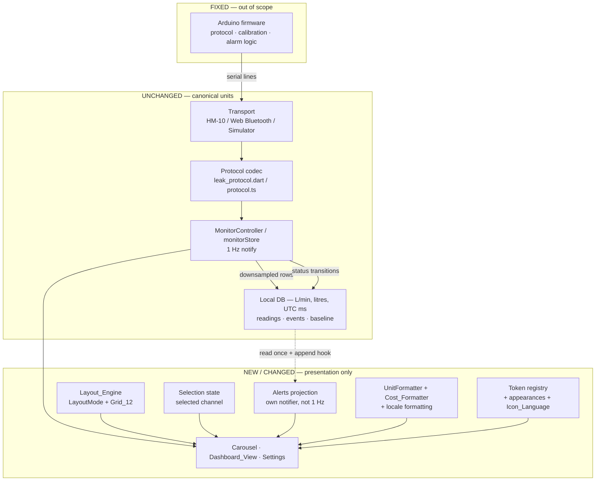
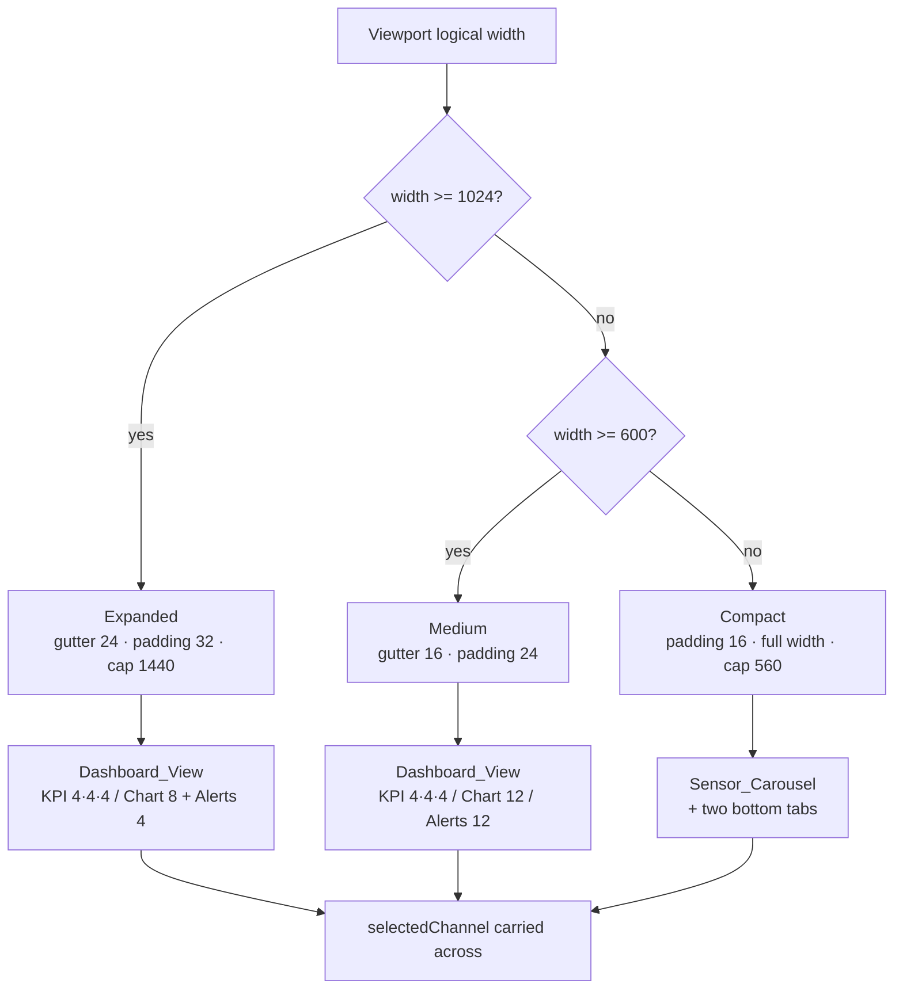
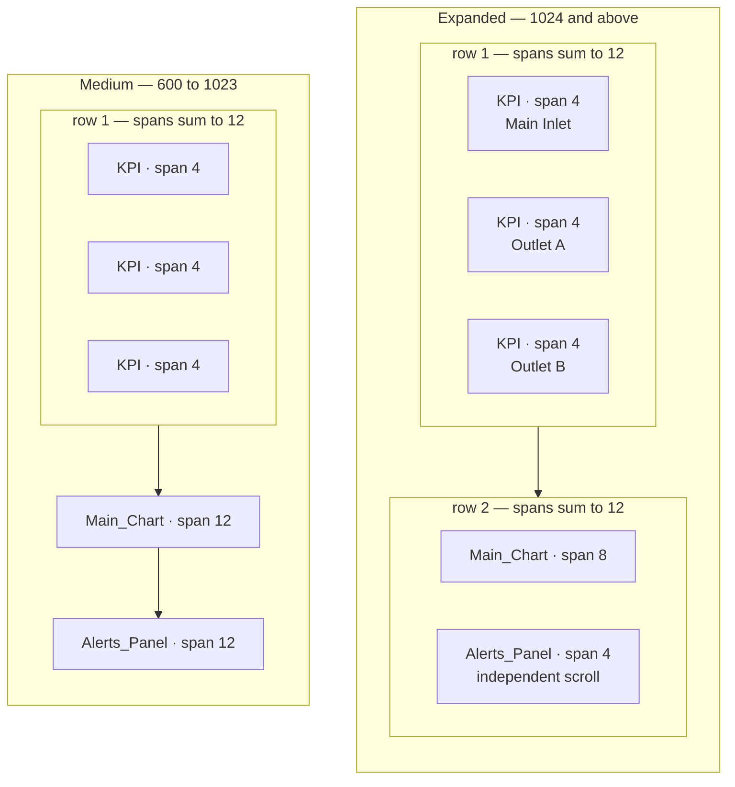
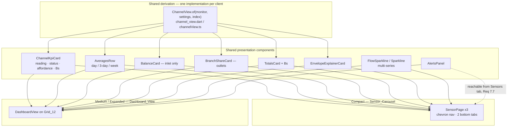
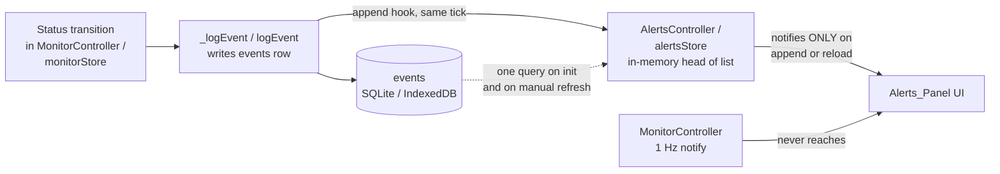

# Design Document

## Overview

This feature reworks the presentation layer of two existing, working clients so that both fully implement the WattVision design system, gain a wide-viewport dashboard, and gain a Bolivianos cost equivalence — without touching the firmware, the wire protocol, the calibration dataset, or the alarm logic.

The starting point matters for the shape of this design. Both clients already transcribe the WattVision tokens correctly: `flutter_app/lib/core/theme/design_tokens.dart` and `react_app/src/styles/tokens.css` were verified against the kit and every §2 colour, the 16 radius, the 20 card padding, the 1 hairline, and the 24/32/14/12 type scale are present and correct. The `#252525` row-hover colour required by Requirement 8.2 is already the `surface-raised` / `darkSurfaceRaised` token. So this is not a re-skin. It is five distinct pieces of work layered onto a codebase whose visual vocabulary is already right:

1. **Make compliance mechanical.** The tokens are correct today by inspection. Requirement 1 demands they stay correct by assertion — a registry that is machine-readable, plus a scan that fails when a literal colour appears outside it.
2. **Add a Layout_Engine and Grid_12.** Both clients currently render a single phone-width column (React hard-caps at 560 CSS px). Requirements 2 and 3 add three named width bands and a 12-column composition for the two wider ones.
3. **Add the Dashboard_View** as a second presentation of the same per-channel data, sharing components with the Compact carousel rather than duplicating them (Requirements 3, 4).
4. **Add a Tariff and a Cost_Formatter** as a strictly presentation-only layer over canonical litres (Requirements 5, 6, 12).
5. **Add the Alerts_Panel** as a new read path over the event log that already exists in both databases (Requirement 7).

Two cross-cutting concerns thread through all of it: appearance modes including a new High_Contrast_Dark (Requirement 9), and accessibility with asserted contrast (Requirement 11). Requirement 13 is the guardrail — both clients must keep building clean and must agree with each other.

### Research findings that shaped the design

**The accent colour passes contrast on dark, and fails on light.** Requirement 11.3 asks for an asserted contrast ratio for `#00E5FF` on `#1E1E1E`. Computing the WCAG 2.1 relative luminance for both gives L(accent) ≈ 0.6327 and L(card) ≈ 0.0130, a ratio of **10.84:1**. The accent comfortably passes 4.5:1 on the dark card surface, so the conditional fallback in Requirement 11.4 stays dormant in the dark appearances, and the assertion is a regression guard rather than a blocker. Secondary text `#98989D` on `#1E1E1E` computes to **5.80:1**, also passing.

The light appearance is a different story. Its accent `#0091A7` on `#FFFFFF` computes to **3.74:1** — below the 4.5:1 threshold — and that colour is currently used as *text* in `.section__title` and `.row__value`. Requirement 11.4 therefore does fire, in the light appearance only. The design resolves it by splitting the accent into a graphical token and a text token (`--accent-text` / `AppPalette.accentText`), with the light text variant darkened to `#00707F` (**5.79:1**). In the dark appearances the text token simply aliases the accent, so nothing changes there.

**The Compact regression risk is avoidable.** Removing `.app { max-width: 560px }` outright would change every screen at every width. Because the Layout_Engine already has to know when it is in Compact, the cap can be re-expressed as a Compact-only rule, leaving phone rendering byte-identical and confining the blast radius to Medium and Expanded.

**The event log needs no schema change.** `events.kind` is a free-text column in SQLite and a TypeScript string union in IndexedDB. Adding a WATCH entry kind is additive in both, which keeps Requirement 13.7 (preserve existing database schema behaviour) satisfiable without a migration.

**The 1 Hz re-query problem is already solved once, and the fix generalises.** `DiagnosticsSheet`'s events tab loads once in `initState` / `useEffect` precisely because its parent re-renders at 1 Hz with telemetry. The Alerts_Panel sits *inside* the dashboard, so it cannot rely on being opened and closed. The design gives it its own notifier that fires only on append or reload, so the 1 Hz telemetry stream never reaches it.

### Requirements traceability map

| Design section | Requirements |
|---|---|
| Layout_Engine | 2.1, 2.9, 2.10, 2.11, 13.1 |
| Grid_12 | 2.2–2.8, 2.11 |
| Dashboard_View composition | 3.1–3.4, 3.10 |
| Shared channel components | 3.5, 3.6, 4.1, 4.2, 4.5, 4.6, 13.1 |
| Selection state | 4.3, 4.4 |
| Layout transition motion | 4.7, 4.8, 11.6 |
| Main_Chart | 3.7, 3.8, 3.9 |
| Tariff settings | 5.1–5.8, 12.5 |
| Cost_Formatter | 6.1–6.9, 12.1–12.4, 13.8 |
| Alerts_Panel | 7.1–7.9, 8.4 |
| Table styling | 8.1–8.3, 8.5–8.7 |
| Appearance modes | 9.1–9.8 |
| Icon_Language | 10.1–10.5 |
| Accessibility | 11.1–11.10 |
| Locale | 12.1–12.7 |
| Token registry and compliance suite | 1.1–1.11, 11.3 |
| Parity and build verification | 13.2–13.10 |

---

## Architecture

### Layer boundaries

Nothing below the presentation layer moves. The transports, the protocol codecs, the two databases, and the alarm interpretation stay exactly as they are. Every addition in this feature lands in one of three places: a new presentation-only formatting layer, a new layout layer, or a new read-only projection over the event log.



**Requirements: 13.8, 13.9, 13.7**

### Layout_Engine — Flutter

`LayoutMode` is a three-value enum living in a new `lib/core/layout/layout_mode.dart`, together with the one authoritative threshold table and the per-mode gutter and padding values.

Resolution uses `LayoutBuilder`, not `MediaQuery`. The reason is that `MediaQuery.sizeOf` reports the window, while `LayoutBuilder` reports the constraints actually handed to the subtree — which is what matters when the app runs in an Android split-screen pane or a resized desktop window, and is what keeps the Flutter and React semantics equivalent (a CSS pixel width is the element's width, not the screen's).

The resolved mode reaches descendants through an `InheritedWidget`, `LayoutScope`, not through `provider`. Two reasons. First, the mode is derived from build-time constraints rather than from mutable application state, so a `ChangeNotifier` would be modelling it wrongly. Second, `InheritedWidget` is precisely the mechanism that already carries `AppPalette` down the tree via `ThemeExtension`, so this is the established pattern in this codebase rather than a new one.

Placement is inside `RootView`, wrapping the `AnimatedSwitcher`, so both the Connection_Gate and the `AppShell` see the mode. That keeps the gate free to centre itself on a wide screen without a second resolution site.

```dart
// lib/core/layout/layout_mode.dart
enum LayoutMode { compact, medium, expanded }

class Breakpoints {
  const Breakpoints._();
  static const double medium = 600;    // Req 2.1
  static const double expanded = 1024; // Req 2.1
  static const double contentMax = 1440; // Req 2.6

  static LayoutMode resolve(double width) {
    if (width >= expanded) return LayoutMode.expanded;
    if (width >= medium) return LayoutMode.medium;
    return LayoutMode.compact;
  }
}

// lib/core/layout/layout_scope.dart
class LayoutScope extends InheritedWidget {
  const LayoutScope({super.key, required this.mode, required super.child});
  final LayoutMode mode;

  static LayoutMode of(BuildContext context) =>
      context.dependOnInheritedWidgetOfExactType<LayoutScope>()?.mode ??
      LayoutMode.compact;

  // The critical line: dependents rebuild only when the BAND changes, never on
  // a pixel-by-pixel resize.
  @override
  bool updateShouldNotify(LayoutScope old) => old.mode != mode;
}
```

That `updateShouldNotify` is what defuses the `AppShell` risk. `LayoutBuilder` does rebuild its builder callback on every constraint change, so the builder body is kept to nothing but constructing `LayoutScope` around a `const` child. `AppShell` and both mounted tab layers are `const` subtrees that do not depend on `LayoutScope` themselves; only the leaf widgets that actually change shape call `LayoutScope.of`. A drag-resize therefore re-runs one cheap builder per frame and rebuilds nothing else until a threshold is crossed, so the `Stack` + `TickerMode` arrangement that keeps both tabs alive is untouched.

**Requirements: 2.1, 2.9, 2.11, 13.1**

### Layout_Engine — React

The three thresholds live in TypeScript, in a new `src/core/layout.ts`, and they are the single authority. CSS does not restate them.

The mechanism: a `useLayoutMode()` hook built on three `window.matchMedia` queries constructed *from* the TS constants. `matchMedia` is preferred over a `resize` listener because the browser fires a change event only when a boundary is actually crossed, so React re-renders once per band change instead of once per pointer move — the same economy the Flutter side gets from `updateShouldNotify`. The hook is the only place that touches the DOM for layout, and it publishes the result as an attribute:

```ts
document.documentElement.dataset.layout = mode; // 'compact' | 'medium' | 'expanded'
```

All CSS then keys off `:root[data-layout='expanded']` attribute selectors rather than `@media (min-width: 1024px)`. This is the answer to "CSS or JS or both": **resolution happens in JS, application happens in CSS, and the numbers exist exactly once.** A compliance test asserts that no `@media (min-width:` / `max-width:` breakpoint appears in the stylesheets, which is what stops the numbers from drifting back apart.

The hook is wired through the same `useSyncExternalStore` shape as the existing stores, so it composes with `monitorStore` and `settingsStore` without a new state paradigm.



**Requirements: 2.1, 2.9, 2.10, 2.11, 13.1**

### Grid_12 — React

CSS Grid, because it gives every one of Requirement 2's constraints natively.

```css
.grid12 {
  display: grid;
  grid-template-columns: repeat(12, minmax(0, 1fr)); /* equal columns — Req 2.2 */
  gap: var(--grid-gutter);
  max-width: var(--grid-content-max);                /* Req 2.6 */
  margin-inline: auto;                               /* Req 2.6 — centred */
  padding-inline: var(--grid-pad);
}

:root[data-layout='expanded'] { --grid-gutter: var(--s4); --grid-pad: var(--s5);
                                --grid-content-max: 1440px; }  /* 24 / 32 — Req 2.3 */
:root[data-layout='medium']   { --grid-gutter: var(--s3); --grid-pad: var(--s4);
                                --grid-content-max: none; }    /* 16 / 24 — Req 2.4 */
:root[data-layout='compact']  { --grid-gutter: var(--s3); --grid-pad: var(--s3);
                                --grid-content-max: 560px; }   /* 16 — Req 2.5 */

.span-4  { grid-column: span 4; }
.span-8  { grid-column: span 8; }
.span-12 { grid-column: span 12; }
```

Two things fall out for free. Gutters and padding are `--s3`/`--s4`/`--s5`, which are already the 16/24/32 steps of the existing 8-multiple spacing scale, so Requirement 1.8 stays true by construction. And CSS Grid auto-placement wraps a child that does not fit the remaining columns onto the next row, which is exactly Requirement 2.8 — no JavaScript involved. In Compact every cell gets `.span-12`, satisfying Requirement 2.5's full-width rule while `--grid-content-max: 560px` preserves today's phone layout unchanged.

**Requirements: 2.2–2.8, 1.8**

### Grid_12 — Flutter

A new `lib/ui/layout/grid12.dart` exposing `Grid12` and `Grid12Cell`, built on `LayoutBuilder` + `Wrap` + `SizedBox`.

```dart
class Grid12 extends StatelessWidget {
  const Grid12({super.key, required this.children});
  final List<Grid12Cell> children;

  @override
  Widget build(BuildContext context) {
    final mode = LayoutScope.of(context);
    final gutter = GridMetrics.gutterFor(mode);   // 24 / 16 / 16
    return LayoutBuilder(
      builder: (context, constraints) {
        final columnWidth =
            (constraints.maxWidth - gutter * 11) / 12;
        return Wrap(
          spacing: gutter,
          runSpacing: gutter,
          crossAxisAlignment: WrapCrossAlignment.start, // same row start — Req 3.3
          children: <Widget>[
            for (final cell in children)
              SizedBox(
                width: columnWidth * cell.span + gutter * (cell.span - 1),
                child: cell.child,
              ),
          ],
        );
      },
    );
  }
}
```

**Why not `GridView`.** `GridView` is a scrollable that imposes a uniform tile extent on every child. The dashboard needs the opposite: cells of wildly different intrinsic heights (a compact KPI card, a tall chart, a scrolling alerts list) laid out inside *one* outer scroll view. Using `GridView` would force either a fixed `childAspectRatio` that clips content at 200% text scale — breaking Requirement 11.10 — or nested scrollables. `Wrap` sizes each run to its tallest child, honours intrinsic heights, and wraps overflow onto the next run, which is Requirement 2.8 for free in the same way CSS Grid gives it to the web client. `Grid12Cell.span` is an `int` asserted to be 1..12 at construction, which is Requirement 2.7 enforced at the type boundary.

The Expanded content cap and centring (Requirement 2.6) are applied one level up, in a `Grid12Scaffold` that wraps the grid in `Center(child: ConstrainedBox(maxWidth: 1440))` plus the mode's outer padding.

**Requirements: 2.2–2.8, 2.6, 3.3**

### Dashboard composition



In Expanded, the KPI_Row is three `Grid12Cell(span: 4)` children — summing to exactly 12, so they occupy one run — followed by `span: 8` and `span: 4`, which also sum to 12 and therefore share the next run with a common top edge. In Medium the second and third rows become `span: 12` each. The composition is data, not branching layout code: a single `List<Grid12Cell>` built from the mode.

**Requirements: 3.1–3.4**

### Sharing between carousel and dashboard

Requirement 4.6 says the carousel and the dashboard must present the same values for a given channel and instant. Satisfying that by careful duplication would be fragile. Instead the derivation is extracted once and both presentations consume it.

A new pure projection — `ChannelView` — takes the monitor snapshot, the settings, and a channel index, and returns everything a channel presentation needs: live flow, the live series, the three window stats, the device status, and the formatted cost strings. It has no dependency on widgets or the DOM, which also makes it the unit the parity fixture tests exercise directly.



Concretely, the following are extracted from today's files:

- `flutter_app/lib/ui/sensors/widgets/sensor_page.dart` currently holds `_LiveReadingCard`, `_FlowingBadge`, `_BalanceCard`, `_BranchShareCard`, `_TotalsCard`, `_EnvelopeExplainerCard` and `_ExplainRow` as private widgets. `_LiveReadingCard` becomes the public `ChannelKpiCard` in a new `channel_kpi_card.dart`; the remaining four cards move to a new `channel_cards.dart` as public widgets. `sensor_page.dart` shrinks to a composition of those.
- `react_app/src/screens/SensorsTab.tsx` holds the same set as local functions — `SensorPage`, `Averages`, `WindowDetail`, `BalanceCard`, `BranchShareCard`, `TotalsCard`, `EnvelopeExplainer`. They move to `src/components/channel/` as exported components. `SensorsTab.tsx` keeps only the carousel chrome; a new `src/screens/DashboardView.tsx` composes the same components on the grid.

Because `ChannelKpiCard` is literally the same widget in the carousel hero slot and in the KPI_Row cell, Requirement 4.6 holds structurally. The only difference between the two uses is a `dense` flag controlling the KPI type size — 32 in the dashboard cell per WattVision §4, larger in the carousel where there is room.

**Requirements: 3.5, 3.6, 4.1, 4.6, 13.1**

### Selected channel state

The carousel's page index currently lives in `_SensorsTabState._page` (Flutter) and `useState` inside `SensorsTab` (React). Both die when the widget or component unmounts — which is exactly what a breakpoint change causes. Requirements 4.3 and 4.4 need the value to outlive that.

It moves up, into state that is mounted above the layout switch:

- Flutter: a new `SelectionController extends ChangeNotifier` in `lib/state/selection_controller.dart`, holding `int selectedChannel`, provided in `main.dart` alongside `MonitorController` and `SettingsController`. The carousel's `PageController` becomes a view of it: page changes write to the controller, and the controller's value seeds `PageController(initialPage:)` when the carousel mounts.
- React: a new module store `src/state/selectionStore.ts` with the same `useSyncExternalStore` shape as `settingsStore`, holding `selectedChannel`.

Session-scoped, not persisted — the requirements ask for continuity across a breakpoint change, not across a restart, and persisting it would add a settings key with no stated need. Because the state is a single integer read by both presentations, both directions of Requirements 4.3 and 4.4 are satisfied by one mechanism rather than two handoffs.

**Requirements: 4.3, 4.4, 4.5**

### Layout transition motion

Requirements 4.7 and 4.8 want an animated transition between presentations when Reduce_Motion is off and no positional interpolation when it is on. Both clients already have the primitive:

- Flutter: `RootView` already uses `AnimatedSwitcher` with `Motion` tokens and already branches on `reduceMotion` to fall back to a plain `FadeTransition`. The presentation swap reuses that pattern one level down, keyed on `LayoutMode`, so a band change cross-fades the carousel into the dashboard. With Reduce_Motion on, the switcher duration collapses and no `AnimatedSlide`/`AnimatedSize` wraps the swap.
- React: `.panel` / `.stagger` animations already route every duration through `--t-fast`/`--t-base`/`--t-slow`, and `:root[data-reduce-motion='true']` already collapses those to 1 ms. The dashboard panel reuses `.panel`, so Requirements 4.8 and 11.6 are satisfied by the existing single-attribute mechanism with no new CSS.

**Requirements: 4.7, 4.8, 11.6**

### Main_Chart

The hand-rolled charts stay hand-rolled — `CustomPainter` in `lib/ui/common/charts.dart`, inline SVG in `src/components/charts.tsx`. That is what lets the tokens apply directly with no theme adapter, and it is why Requirements 3.7 and 3.8 are *already* satisfied: both implementations draw grid lines in the border token, stroke at width 2, and fill with a gradient from the accent into the gradient-green partner.

One capability is missing. Requirement 3.9 needs all three channels plottable simultaneously, and both chart entry points take a single series. Both gain a multi-series signature:

- `FlowSparkline.multi({required List<List<double>> series, required List<Color> colors, ...})`, with the existing single-series constructor retained as a thin delegate so the carousel's call sites are untouched.
- `<Sparkline series={[...]} colors={[...]} />` with the current `values`/`color` props kept as an overload that wraps them into single-element arrays.

Channel selection is a row of multi-select chips above the chart — `.chip[aria-pressed]` already exists in the React stylesheet; Flutter gets `FilterChip`. Selection is independent of `selectedChannel`, because Requirement 3.9 requires all three to be selectable at once while the KPI focus is singular.

The area gradient is drawn per series in draw order. With three overlapping fills the gradients are already low-alpha (0.34 → 0.10 → 0) so stacking reads acceptably; the stroke remains the primary signal.

**Requirements: 3.7, 3.8, 3.9**

### Alerts_Panel read path

The panel is a projection over the existing `events` table / object store. No new storage.



Three design points.

**Requirement 7.3's one-second latency is met by not querying at all.** `_logEvent` / `logEvent` gain an append hook: after the write resolves, the same in-memory `LeakEvent` / `EventRow` is pushed onto the head of the alerts list and the alerts notifier fires. The entry therefore appears in the same frame as the status transition. The database read happens exactly twice in a session — once on initialise, once if the user taps refresh.

**The panel must not share a notifier with telemetry.** This is the generalisation of the fix already applied to `DiagnosticsSheet`'s events tab. `MonitorController.notifyListeners()` fires at 1 Hz; if the alerts list were exposed through it, every telemetry sample would re-render a list of up to 50 rows inside the dashboard. So alerts get their own `ChangeNotifier` (Flutter) and their own module store with its own `useSyncExternalStore` subscription (React). A KPI updating at 1 Hz and an alerts list updating on transitions are separate subscriptions to separate stores.

**WATCH and CAL transitions need to start being logged.** `_handleStatusTransition` currently writes events for LEAK/FAULT raise and clear and for calibration completion, but not for a transition into WATCH. Requirement 7.3 needs one. The change is to the *logging* only — a new `EventKind.watchRaised` / `'WATCH_RAISED'` written from the existing transition branch, which already fires once per change and so cannot flap. The device-reported Status and the alarm interpretation are untouched, satisfying Requirement 7.9. `events.kind` is `TEXT` in SQLite and a string union in TypeScript, so this is additive with no migration, satisfying Requirement 13.7.

The panel filters to alert-worthy kinds (`LEAK_RAISED`, `LEAK_CLEARED`, `FAULT_RAISED`, `FAULT_CLEARED`, `WATCH_RAISED`, `CALIBRATION`) and excludes connection noise, which belongs in the Diagnostics_Sheet event log. The Diagnostics_Sheet keeps showing everything, preserving Requirement 13.10.

In Expanded the panel is a bounded-height card with an inner scroll view (`ConstrainedBox` + `ListView` in Flutter, `max-height` + `overflow-y: auto` in CSS), which is Requirement 7.8. In Compact it is reachable from the Sensors tab as a sheet, satisfying Requirement 7.7 without adding a third bottom tab and so preserving Requirement 4.2.

**Requirements: 7.1–7.9, 13.7, 13.10**

### Appearance modes

Four appearances replace today's three-value `ThemeMode`: **Dark** (default), **High_Contrast_Dark**, **System**, and **Light** (demoted).

Flutter adds `AppPalette.highContrastDark` built with `copyWith` off the existing dark palette, so no token is restated:

```dart
static final AppPalette highContrastDark = dark.copyWith(
  textSecondary: Tokens.hcTextSecondary, // #C7C7CC — Token_Extension
  border:        Tokens.hcBorder,        // #48484A — Token_Extension
  accentText:    Tokens.accent,          // cyan already passes on #1E1E1E
);
```

Background, surface and surface-raised are deliberately inherited unchanged, which is what keeps the appearance "within the WattVision §2 dark family" as Requirement 9.2 states. Only text and border contrast rise.

React does the same through selector grouping rather than duplication:

```css
:root[data-theme='dark'],
:root[data-theme='hc-dark'] { /* the existing dark block, unchanged */ }

:root[data-theme='hc-dark'] {
  --text-secondary: #c7c7cc;
  --border: #48484a;
}
```

`AppPalette` and the CSS both gain `accentText`/`--accent-text`. In all dark appearances it aliases the accent. In light it is `#00707F`, resolving the 3.74:1 failure computed earlier. `.section__title` and `.row__value`, which use the accent as text today, switch to the text token — that is the concrete application of Requirement 11.4.

**Demoting light without breaking it.** The light appearance keeps every token it has and every behaviour it has; only its placement in the Settings tab changes. The primary Appearance control offers Dark, High Contrast Dark and System. Light moves to the Accessibility section as a separate switch, and selecting it shows a persistent advisory that light backgrounds sit outside WattVision guidance for prolonged data reading (Requirements 9.3, 9.4). Because the palette is untouched and the contrast fix above applies to it, Requirement 9.5 holds.

**Persistence migration.** `SettingsController` currently persists `themeMode` as a `ThemeMode.index` (0 = system, 1 = light, 2 = dark). The new `Appearance` enum cannot reuse those indices safely, so a new key `appearance` is written and the loader maps any surviving legacy `themeMode` value once: `0 → system`, `1 → light`, `2 → dark`. React's `settingsStore` already merges parsed JSON over `DEFAULT_SETTINGS`, so it needs the same explicit remap of a legacy `themeMode` string onto the new `appearance` field. This is the only persistence migration in the feature and satisfies Requirement 9.7.

**Requirements: 9.1–9.8, 11.4**

### Icon_Language

The React client currently uses emoji as icons — `💧`, `⚙`, `⚕`, `🧪`, `📡`, `⚠`. Emoji cannot take a token colour and cannot be sized on the spacing or type scale, so Requirements 10.5 and 10.2 force real glyphs. Flutter uses Material icons including `Icons.monitor_heart_outlined` and `Icons.cable_outlined`, which are outside the approved water vocabulary.

The design splits icons into two closed sets:

- **Domain icons** carry water-system meaning and are restricted to the five approved glyphs: droplet, valve, gauge/meter, pipe, wave. Requirement 10.3 asks for the same glyph for the same meaning in both clients, and Material's inventory has no valve or pipe that a chosen SVG would match. So these five are authored once as path data in `design/icons/*.svg` and consumed from that single source: inline `<svg>` components in `react_app/src/components/icons.tsx`, and `Path` objects rendered by a small `CustomPainter` in `flutter_app/lib/ui/common/icon_language.dart`. Rendering them through `CustomPainter` rather than adding `flutter_svg` avoids a new dependency on a toolchain we cannot resolve in this environment.
- **Structural glyphs** carry no domain meaning — chevron, close, check, plus, refresh, expand. These stay as Material icons in Flutter and simple inline SVG in React, and are exempt from the vocabulary restriction. Requirement 10.1 says "every functional icon"; reading that as forbidding a back-chevron would leave navigation unlabelled, so the design declares the narrower reading and records it as an open decision below.

Both clients expose the vocabulary as a named API (`AppIcon.droplet`, `<DropletIcon />`) so the compliance suite can assert that no other glyph source is referenced from UI code, and every call site pairs the icon with a text label or an accessible name per Requirement 10.4.

**Requirements: 10.1–10.5**

---

## Components and Interfaces

### New and changed files — Flutter

| Path | Status | Purpose | Requirements |
|---|---|---|---|
| `lib/core/layout/layout_mode.dart` | new | `LayoutMode`, `Breakpoints`, `GridMetrics` | 2.1, 2.3–2.6 |
| `lib/core/layout/layout_scope.dart` | new | `InheritedWidget` carrying the mode | 2.1, 2.9 |
| `lib/ui/layout/grid12.dart` | new | `Grid12`, `Grid12Cell`, `Grid12Scaffold` | 2.2–2.8 |
| `lib/core/theme/token_registry.dart` | new | machine-readable token + extension specs | 1.1, 1.9, 1.10 |
| `lib/core/money/tariff.dart` | new | parse, validate, quantise, format for editing | 5.3–5.6, 12.5 |
| `lib/core/money/cost_formatter.dart` | new | `Bs_Equivalence` from canonical litres | 6.3–6.7, 12.1–12.4 |
| `lib/core/locale/app_locale.dart` | new | locale resolution and fallback chain | 12.6 |
| `lib/state/selection_controller.dart` | new | selected channel across breakpoints | 4.3, 4.4 |
| `lib/state/alerts_controller.dart` | new | alerts projection with its own notifier | 7.1–7.4 |
| `lib/ui/common/icon_language.dart` | new | five domain glyphs + structural set | 10.1–10.5 |
| `lib/ui/common/data_table_row.dart` | new | hover/focus row styling primitive | 8.1–8.4 |
| `lib/ui/sensors/widgets/channel_kpi_card.dart` | extracted | was `_LiveReadingCard` | 3.5, 4.6 |
| `lib/ui/sensors/widgets/channel_cards.dart` | extracted | was the four private cards | 4.6 |
| `lib/ui/sensors/channel_view.dart` | new | pure per-channel derivation | 4.6, 13.2 |
| `lib/ui/dashboard/dashboard_view.dart` | new | Grid_12 composition | 3.1–3.4 |
| `lib/ui/dashboard/alerts_panel.dart` | new | Alert_Entry list | 7.1–7.8 |
| `lib/core/theme/design_tokens.dart` | changed | `accentText`, HC tokens, extension metadata | 1.9, 1.10, 11.4 |
| `lib/core/theme/app_theme.dart` | changed | `highContrastDark`, `accentText` field | 9.1, 9.2 |
| `lib/data/settings/app_settings.dart` | changed | `Appearance`, tariff fields, locale override | 5.1–5.8, 9.1–9.3 |
| `lib/data/settings/settings_controller.dart` | changed | new keys + legacy `themeMode` migration | 9.7 |
| `lib/state/monitor_controller.dart` | changed | WATCH event + alerts append hook | 7.3 |
| `lib/data/models/stored_reading.dart` | changed | `EventKind.watchRaised` | 7.3 |
| `lib/ui/root_view.dart` | changed | hosts `LayoutBuilder` + `LayoutScope` | 2.1 |
| `lib/ui/shell/app_shell.dart` | changed | rail in Medium/Expanded, tabs in Compact | 3.10, 4.2 |
| `lib/ui/sensors/sensors_tab.dart` | changed | reads `SelectionController` | 4.3, 4.4 |
| `lib/ui/sensors/widgets/sensor_page.dart` | changed | composes extracted cards | 4.6 |
| `lib/ui/common/charts.dart` | changed | multi-series sparkline | 3.9 |
| `lib/ui/diagnostics/diagnostics_sheet.dart` | changed | Calibration_Table restyle | 8.1–8.3, 8.5–8.7 |
| `lib/ui/settings/settings_tab.dart` | changed | tariff, appearance, accessibility sections | 5.1–5.8, 9.1–9.4 |

### New and changed files — React

| Path | Status | Purpose | Requirements |
|---|---|---|---|
| `src/core/layout.ts` | new | thresholds, `resolveLayoutMode`, metrics | 2.1, 2.3–2.6 |
| `src/hooks/useLayoutMode.ts` | new | `matchMedia` resolution + `data-layout` | 2.1, 2.9 |
| `src/core/tariff.ts` | new | parse, validate, quantise, format | 5.3–5.6, 12.5 |
| `src/core/cost.ts` | new | `Bs_Equivalence` formatter | 6.3–6.7, 12.1–12.4 |
| `src/core/locale.ts` | new | locale resolution and fallback | 12.6 |
| `src/core/channelView.ts` | new | pure per-channel derivation | 4.6, 13.2 |
| `src/state/selectionStore.ts` | new | selected channel | 4.3, 4.4 |
| `src/state/alertsStore.ts` | new | alerts projection, own subscription | 7.1–7.4 |
| `src/components/icons.tsx` | new | five domain glyphs + structural set | 10.1–10.5 |
| `src/components/channel/*.tsx` | extracted | KPI card, averages, balance, share, totals | 3.5, 4.6 |
| `src/screens/DashboardView.tsx` | new | Grid_12 composition | 3.1–3.4 |
| `src/components/AlertsPanel.tsx` | new | Alert_Entry list | 7.1–7.8 |
| `src/styles/tokens.css` | changed | `--accent-text`, `hc-dark`, grid vars | 1.9, 9.2, 11.4 |
| `src/styles/global.css` | changed | `.grid12`, spans, layout-scoped `.app` cap | 2.2–2.6, 2.10 |
| `src/styles/token-registry.json` | new | machine-readable registry mirror | 1.1, 1.9, 1.10 |
| `src/state/settingsStore.ts` | changed | tariff, appearance, locale fields | 5.1–5.8, 9.1 |
| `src/state/monitorStore.ts` | changed | WATCH event + alerts append hook | 7.3 |
| `src/data/db.ts` | changed | `'WATCH_RAISED'` added to `EventKind` | 7.3 |
| `src/App.tsx` | changed | layout hook, appearance resolution, routing | 2.10, 9.1 |
| `src/screens/SensorsTab.tsx` | changed | carousel chrome only | 4.1 |
| `src/components/charts.tsx` | changed | multi-series sparkline | 3.9 |
| `src/components/DiagnosticsSheet.tsx` | changed | Calibration_Table restyle | 8.1–8.7 |
| `src/screens/SettingsTab.tsx` | changed | tariff, appearance, accessibility | 5.1–5.8, 9.1–9.4 |

### Cost_Formatter interface

The formatter sits **beside** `UnitFormatter` / `createFormatter`, never inside it, and it accepts only canonical litres. That placement is the structural guarantee for Requirements 6.3, 6.6 and 6.7: because the display unit never enters the call, a change of display unit cannot change the result.

```dart
// lib/core/money/cost_formatter.dart
class CostFormatter {
  const CostFormatter({
    required this.tariffBsPerCubicMetre,
    required this.locale,
    required this.enabled,
    required this.isDefaultTariff,
  });

  /// Null when display is disabled — callers render the volume alone (Req 5.8).
  String? format(double canonicalLitres) {
    if (!enabled) return null;
    final bs = canonicalLitres / 1000.0 * tariffBsPerCubicMetre; // Req 6.3
    return 'Bs. ${NumberFormat('#,##0.00', locale).format(bs)}';  // Req 6.4, 12.1–12.4
  }
}
```

```ts
// src/core/cost.ts
export function createCostFormatter(o: CostOptions) {
  const nf = new Intl.NumberFormat(o.locale, {
    minimumFractionDigits: 2, maximumFractionDigits: 2,
  });
  return {
    format(canonicalLitres: number): string | null {
      if (!o.enabled) return null;
      return `Bs. ${nf.format((canonicalLitres / 1000) * o.tariffBsPerM3)}`;
    },
  };
}
```

Note the currency prefix is a literal `'Bs. '`, not `Intl.NumberFormat`'s `style: 'currency'` with `BOB`. Requirement 12.4 demands the same `Bs.` prefix in every locale, and the ICU currency symbol for BOB varies by locale and would render `BOB` in `en`. The number *body* is locale-formatted; the prefix is not. That split is deliberate and is what makes Requirements 12.2, 12.3 and 12.4 simultaneously satisfiable.

`isDefaultTariff` drives Requirement 6.8's "default tariff in use" indication. `Bs_Equivalence` is rendered in the secondary text colour at the body type size next to a primary volume figure (Requirement 6.5), and passes through the existing `AnimatedMetric` / `useAnimatedNumber` for Requirement 6.9.

### Tariff interface

```dart
sealed class TariffParse {
  const TariffParse();
}
class TariffOk extends TariffParse { final double value; }
class TariffInvalid extends TariffParse { final String message; }

class Tariff {
  static const double min = 0;      // exclusive — Req 5.3
  static const double max = 1000;   // inclusive — Req 5.3
  static const double defaultValue = 5.0; // placeholder — Req 5.2
  static const int decimals = 4;    // Req 5.5

  static double quantise(double v) => (v * 10000).round() / 10000;
  static TariffParse parse(String text, String locale);
  static String formatForEditing(double v, String locale);
  static String formatForDisplay(double v, String locale);
}
```

Two formatters, not one, and the distinction matters for the round-trip property. `formatForEditing` emits an ungrouped decimal using the active locale's decimal separator and trims trailing zeros — that is what goes into the text field, and it is the representation over which Requirement 5.6's round-trip holds. `formatForDisplay` adds grouping separators for read-only presentation. Stating the property over the editing representation is what makes it true rather than nearly true.

`parse` accepts both `,` and `.` as the decimal separator regardless of locale, because a user typing on a hardware keyboard may produce either (Requirement 12.5, read generously). It rejects strings containing both, and rejects non-numeric input, zero, negatives, and values above 1000 with a message stating the accepted range (Requirement 5.4). Rejection leaves the persisted value untouched.

### Locale resolution

Both clients resolve in the same order, and the chain is Requirement 12.6:

1. An explicit user override in settings, if one is set.
2. The platform locale's language code, if it is one of the supported set `{es, en}`.
3. `en`.

Flutter reads the platform locale from `PlatformDispatcher.instance.locale` and sets `Intl.defaultLocale` once at startup; number formatting uses `NumberFormat` and dates use `DateFormat` with an explicit locale argument. `intl 0.20.3` is already a dependency and already used in `diagnostics_sheet.dart` via `DateFormat('d MMM · HH:mm:ss')`, so no new package is needed. React uses `navigator.language` with `Intl.NumberFormat` and `Intl.DateTimeFormat`, both of which are platform built-ins.

Full Spanish interface copy is out of scope per the requirements' open decision 2 — this is number, currency and date formatting only. Timestamps in the Alerts_Panel and the event log use the locale's date and time conventions (Requirement 12.7).

### Table row styling

The `#252525` hover colour Requirement 8.2 asks for is already the `surface-raised` token in both clients, so no new colour is introduced.

React needs focus handling added to what exists. `.table tr:hover td` is already present; rows gain `tabindex="0"` and the rule extends to `.table tr:focus-within td`, with the existing global `:focus-visible` outline providing the visible indicator Requirement 8.3 wants. Numeric cells get the existing `.mono` class and `text-align: right` for Requirement 8.5. Requirement 8.7's Compact behaviour is `overflow-x: auto` on a wrapper around the table, with no font-size reduction below `--size-label`.

Flutter gets a `DataTableRow` primitive built on `FocusableActionDetector`, which surfaces `onShowHoverHighlight` and `onShowFocusHighlight` through one widget and has been in the framework since 1.20 — a deliberately conservative choice given the toolchain could not be exercised here. The table itself uses the plain `Table` widget rather than `DataTable`: `DataTable` imposes its own row heights and theming that would fight the tokens, while `Table` takes explicit `columnWidths` and leaves styling to us. Compact wraps it in a horizontal `SingleChildScrollView`.

The same row treatment applies to Alert_Entry rows, which is Requirement 8.4 — one primitive, two call sites.

**Requirements: 8.1–8.7**

---

## Data Models

### Settings additions

Both clients add the same five fields. The Flutter side is an immutable `AppSettings` with `copyWith`; the React side is a plain interface merged over `DEFAULT_SETTINGS`.

| Field | Type | Default | Purpose | Requirements |
|---|---|---|---|---|
| `appearance` | `Appearance` / `'dark' \| 'hc-dark' \| 'light' \| 'system'` | `dark` | replaces `themeMode` | 9.1–9.3, 9.6, 9.7 |
| `tariffBsPerCubicMetre` | `double` / `number` | `5.0` | water price, 4 dp | 5.1, 5.2, 5.5 |
| `tariffConfiguredByUser` | `bool` / `boolean` | `false` | drives the default-in-use hint | 5.2, 6.8 |
| `showCostEquivalence` | `bool` / `boolean` | `true` | master switch for `Bs_Equivalence` | 5.8, 6.1 |
| `localeOverride` | `String` / `string` | `''` (system) | locale chain step 1 | 12.6 |

`themeMode` is removed from the model and survives only as a legacy key read once during migration. Every other existing field — units, alert toggles, `autoReconnect`, `sensorNames`, `loggingInterval`, `retention`, `autoPrune`, `showEnvelopeDetails`, `requireConnectionToBrowse`, `reduceMotion` — is untouched, which is Requirements 13.6 and 13.7.

The tariff lives only in the settings store. Nothing monetary is written to `readings` or `events`, satisfying Requirements 5.7 and 6.6.

### Token registry

The registry is the data structure that makes Requirement 1 assertable. Flutter gets a typed list; React gets JSON, because CSS cannot carry structured metadata.

```dart
// lib/core/theme/token_registry.dart
class TokenSpec {
  const TokenSpec({
    required this.name,
    required this.argb,
    required this.section, // '§2' | '§3' | '§4' | '§5'
  });
  final String name;
  final int argb;
  final String section;
}

class TokenExtensionSpec {
  const TokenExtensionSpec({
    required this.name,
    required this.argb,
    required this.rationale,  // Req 1.9 — why it is absent from WattVision
    required this.consumedBy, // Req 1.9 — which state or surface uses it
  });
}

const List<TokenSpec> kWattVisionTokens = <TokenSpec>[
  TokenSpec(name: 'background',     argb: 0xFF121212, section: '§2'),
  TokenSpec(name: 'surface',        argb: 0xFF1E1E1E, section: '§2'),
  TokenSpec(name: 'accent',         argb: 0xFF00E5FF, section: '§2'),
  TokenSpec(name: 'alert',          argb: 0xFFFF453A, section: '§2'),
  TokenSpec(name: 'normal',         argb: 0xFF32D74B, section: '§2'),
  TokenSpec(name: 'gradientGreen',  argb: 0xFF30D158, section: '§2'),
  TokenSpec(name: 'surfaceRaised',  argb: 0xFF252525, section: '§2'),
  TokenSpec(name: 'border',         argb: 0xFF2C2C2E, section: '§2'),
  TokenSpec(name: 'textPrimary',    argb: 0xFFFFFFFF, section: '§2'),
  TokenSpec(name: 'textSecondary',  argb: 0xFF98989D, section: '§2'),
  TokenSpec(name: 'alertBoxFill',   argb: 0xFF3A1C1C, section: '§2'),
  // ... §3 geometry, §4 type, §5 spacing as numeric specs
];

const List<TokenExtensionSpec> kTokenExtensions = <TokenExtensionSpec>[
  TokenExtensionSpec(
    name: 'watch',
    argb: 0xFFFFD60A,
    rationale: 'WattVision §2 supplies no intermediate advisory colour between '
               'the secondary accent and the alert accent.',
    consumedBy: 'WATCH status pill, watch banner, envelope gauge negative breach',
  ),
  // watchBoxFill, normalBoxFill, idle, hcTextSecondary, hcBorder,
  // lightAccentText, and the whole derived light palette follow the same shape.
];
```

`react_app/src/styles/token-registry.json` mirrors this, keyed by custom property name. The React compliance test asserts the relationship in **both** directions: every registry key appears in `tokens.css` with the stated value, and every custom property defined in `tokens.css` appears in the registry. The bidirectional check is what makes an undocumented new token a test failure rather than a silent addition, which is how Requirement 1.9 gets teeth.

The eleven exact colour values Requirement 1.6 enumerates, and the six numeric values Requirement 1.7 enumerates, are asserted directly against this registry.

**Requirements: 1.1, 1.6, 1.7, 1.9, 1.10**

### Alert_Entry

A view model, not a stored row. It is projected from the existing event record and adds nothing to either schema.

```ts
interface AlertEntry {
  ts: number;             // epoch ms, formatted per locale at render — Req 12.7
  kind: EventKind;        // existing union + 'WATCH_RAISED'
  status: LeakStatus;     // derived from kind — Req 7.2
  channelName: string;    // from settings.sensorNames — Req 7.2
  summary: string;        // the existing event message — Req 7.2
  severity: 'alarm' | 'advisory' | 'info';  // drives §3 alert styling — Req 7.5
  affordance: string;     // non-colour signal — Req 7.6, 11.5
}
```

`severity` maps `LEAK_RAISED` and `FAULT_RAISED` to `alarm`, which is what selects the WattVision §3 alert treatment Requirement 7.5 specifies: `#3A1C1C` fill, `#FF453A` text, and a 4-wide left border in `#FF453A`. Both clients already have that treatment — `SurfaceCard(leadingAccentBar: true)` in Flutter and `.banner { border-left: 4px solid currentColor }` in React — so it is reused rather than rebuilt.

`channelName` deserves a note. The current event messages are whole-system statements (a leak is an inlet-versus-outlet mismatch, not a single channel's fault), so entries derived from balance events name the inlet channel, and per-channel attribution is only available where the event carries it. This is honest about what the firmware reports and does not invent attribution.

### Layout metrics

```ts
export const BREAKPOINTS = { medium: 600, expanded: 1024 } as const;
export const CONTENT_MAX = 1440;

export const GRID_METRICS = {
  compact:  { gutter: 16, pad: 16, contentMax: 560  },
  medium:   { gutter: 16, pad: 24, contentMax: null },
  expanded: { gutter: 24, pad: 32, contentMax: 1440 },
} as const;
```

Every gutter and padding value is a multiple of 8, which the compliance suite asserts rather than assumes (Requirement 1.8). The Compact `contentMax` of 560 is the *existing* `.app` cap, relocated rather than deleted — the mitigation for the highest-risk change in this feature.

**Requirements: 2.1, 2.3–2.6, 1.8**

---

## Correctness Properties

A property is a characteristic or behaviour that should hold true across all valid executions of a system — essentially, a formal statement about what the system should do. Properties serve as the bridge between human-readable specifications and machine-verifiable correctness guarantees.

Much of this feature is well suited to property-based testing despite it being UI work, because the hard parts are pure: breakpoint resolution, grid arithmetic, row packing, tariff parsing, cost formatting, locale formatting, contrast computation and event projection are all functions with inputs and outputs. The parts that are genuinely not property-testable — where a card sits on screen, whether a gradient looks right — are handled by the example and snapshot tests described in the Testing Strategy.

Each property below names its generators and its invariant.

### Property 1: Layout_Mode resolution is total and exclusive

*For any* viewport logical width in the range 320 to 2560, the Layout_Engine resolves exactly one Layout_Mode, and that mode agrees with the band definition: Compact below 600, Medium from 600 to 1023 inclusive, Expanded at 1024 and above.

Generators: `width` — integers and reals in [320, 2560], biased to include 599, 600, 601, 1023, 1024, 1025.
Invariant: `resolve(w)` returns a non-null mode; exactly one of the three band predicates holds for `w`; and the returned mode is the one whose predicate holds.

**Validates: Requirements 2.1, 2.11**

### Property 2: Grid_12 arithmetic conserves the available width

*For any* Layout_Mode and *any* available content width, the twelve computed column widths are equal, and twelve columns plus eleven gutters exactly fill the available width.

Generators: `mode` — the three Layout_Modes; `width` — reals in [320, 2560].
Invariant: all twelve column widths are equal within floating-point tolerance; `12 * columnWidth + 11 * gutter == availableWidth` within tolerance; `columnWidth > 0`.

**Validates: Requirements 2.2, 2.3, 2.4, 2.5**

### Property 3: Expanded content is capped and centred without horizontal overflow

*For any* viewport logical width of 1024 or greater, the grid content width never exceeds 1440, the left and right remainders around the content are equal, and the content width plus twice the outer padding never exceeds the viewport width.

Generators: `width` — reals in [1024, 2560].
Invariant: `contentWidth <= 1440`; `leftRemainder == rightRemainder` within tolerance; `contentWidth + 2 * pad <= width`.

**Validates: Requirements 2.6, 2.11**

### Property 4: Row packing never exceeds twelve columns and preserves every cell

*For any* list of column spans, each a whole number from 1 to 12, the packer produces rows whose spans each sum to at most 12, and the concatenation of the rows equals the original list in order — no cell dropped, duplicated or reordered.

Generators: `spans` — lists of length 0 to 30 drawn from integers [1, 12].
Invariant: every produced row sums to `<= 12`; flattening the rows yields the input list exactly; every span in the output is an integer in [1, 12].

**Validates: Requirements 2.7, 2.8**

### Property 5: Channel selection survives any sequence of Layout_Mode changes

*For any* starting channel index and *any* sequence of Layout_Mode changes, the selected channel after the sequence equals the selected channel before it, and the presentation that mounts in each mode opens on that channel.

Generators: `channel` — integers [0, 2]; `modeSequence` — lists of length 1 to 10 drawn from the three Layout_Modes.
Invariant: `selection.channel` is unchanged across the whole sequence; after each transition the mounted presentation's initial channel equals `selection.channel`. This is a round-trip property: Compact to wide and back yields the identity.

**Validates: Requirements 4.3, 4.4**

### Property 6: Live state is retained across a Layout_Mode change

*For any* pair of Layout_Modes and *any* monitor state, changing the mode leaves the link state, the buffered reading history and the active tab selection unchanged.

Generators: `fromMode`, `toMode` — the three Layout_Modes; `history` — lists of 0 to 200 synthetic telemetry samples.
Invariant: `linkState`, `liveSeries` contents and the active tab identifier are equal before and after the transition.

**Validates: Requirements 4.5**

### Property 7: The carousel and the dashboard agree on every channel value

*For any* telemetry snapshot, *any* aggregate snapshot, *any* settings configuration and *any* channel index, the values presented by the Sensor_Carousel and by the Dashboard_View for that channel are identical, compared as formatted strings — live reading, Status, the per-day, per-3-day and per-week averages, and the Bs_Equivalence.

Generators: `telemetry` — synthetic snapshots with flows in [0, 60] L/min and volumes in [0, 10^6] L across all six Status values; `aggregates` — window stats with arbitrary coverage in [0, 1]; `settings` — cross product of flow unit, volume unit, tariff and locale; `channel` — integers [0, 2].
Invariant: for each of the six compared figures, the string produced through the carousel path equals the string produced through the dashboard path. Both paths resolve through the single `ChannelView` projection, so the property verifies that neither presentation re-derives anything locally.

**Validates: Requirements 4.6**

### Property 8: Tariff validation accepts exactly the stated range

*For any* input string, the Tariff control accepts it if and only if it parses to a number strictly greater than 0 and at most 1000; on rejection the persisted Tariff is unchanged and a message stating the accepted range is produced.

Generators: `text` — a mixture of well-formed decimals in and out of range, values at the boundaries 0, 0.0001, 1000, 1000.0001, strings with locale decimal separators, strings with both separators, empty strings, whitespace, alphabetic strings, `NaN`, `Infinity`, and strings with leading and trailing whitespace.
Invariant: acceptance is equivalent to the range predicate; on rejection the stored value equals the pre-call value and the returned message is non-empty.

**Validates: Requirements 5.3, 5.4**

### Property 9: Tariff parse and format round-trip

*For any* Tariff value in the range (0, 1000] and *any* supported locale, quantising the value to 4 decimal places, formatting it for editing, and parsing the result yields the same quantised value.

Generators: `value` — reals in (0, 1000] including values requiring exactly 4 decimal places and values with more; `locale` — the supported locale set `{es, en}`.
Invariant: `parse(formatForEditing(quantise(v), locale), locale) == quantise(v)` exactly; and `quantise(v)` has at most 4 decimal places. The round-trip is stated over the editing representation, which is ungrouped, because that is the string the control actually holds.

**Validates: Requirements 5.5, 5.6, 12.5**

### Property 10: Bs_Equivalence is the canonical volume in cubic metres times the Tariff, at two decimals

*For any* canonical litre volume and *any* Tariff in (0, 1000], the Cost_Formatter produces a string prefixed with `Bs.` and a space, whose numeric body equals litres divided by 1000 multiplied by the Tariff, rendered with exactly two fractional digits in the active locale.

Generators: `litres` — reals in [0, 10^7] including 0 and very small values; `tariff` — reals in (0, 1000]; `locale` — `{es, en}`.
Invariant: the output matches the `Bs. ` prefix; parsing the numeric body with the locale's separators recovers `litres / 1000 * tariff` rounded to two decimals; the body has exactly two fractional digits.

**Validates: Requirements 6.3, 6.4**

### Property 11: Bs_Equivalence is invariant under a change of displayed volume unit

*For any* canonical litre volume, *any* Tariff and *any* two distinct volume units, the Bs_Equivalence string is identical for both units while the volume string differs.

Generators: `litres` — reals in (0, 10^7]; `tariff` — reals in (0, 1000]; `unitA`, `unitB` — distinct members of the volume unit set.
Invariant: `cost(litres, tariff)` under `unitA` equals `cost(litres, tariff)` under `unitB`; and `volumeText(litres, unitA) != volumeText(litres, unitB)` for units with different multipliers. The property holds structurally because the formatter's signature accepts only canonical litres, and this test is what prevents a future refactor from threading the display unit in.

**Validates: Requirements 6.7, 13.8**

### Property 12: Disabling cost display suppresses the Bs_Equivalence and nothing else

*For any* canonical litre volume, when Bs_Equivalence display is disabled the Cost_Formatter yields no value and the volume figure is unchanged; when enabled it yields a value and the volume figure is still unchanged.

Generators: `litres` — reals in [0, 10^7]; `enabled` — booleans.
Invariant: `format(litres) == null` iff `!enabled`; the volume string is identical in both cases.

**Validates: Requirements 5.8, 6.1**

### Property 13: The Alerts_Panel is ordered newest-first and loses nothing

*For any* set of event records with arbitrary timestamps, including duplicates and out-of-order arrival, the projected Alert_Entry list is non-increasing in timestamp and is exactly a permutation of the alert-worthy subset of the input.

Generators: `events` — lists of 0 to 200 records drawn from every `EventKind`, with timestamps in an arbitrary order including equal values.
Invariant: for every adjacent pair, `ts[i] >= ts[i+1]`; the output multiset equals the input multiset filtered to the alert-worthy kinds; no non-alert kind appears.

**Validates: Requirements 7.1, 7.9**

### Property 14: Every Alert_Entry carries a complete, non-empty presentation

*For any* event record of any kind, the projected Alert_Entry has a non-empty formatted timestamp, a non-empty channel name, a Status drawn from the device vocabulary, a non-empty summary, and a Status_Affordance.

Generators: `event` — records across every `EventKind`, with empty and very long message strings, missing optional balance and threshold values, and every sensor-name configuration.
Invariant: all five fields are present and non-empty; `status` is a member of the Status vocabulary.

**Validates: Requirements 7.2, 7.6**

### Property 15: Every qualifying Status transition produces exactly one Alert_Entry

*For any* pair of distinct Status values whose target is WATCH, LEAK, FAULT or CAL, feeding that transition to the monitor appends exactly one Alert_Entry, and feeding a transition whose source equals its target appends none.

Generators: `fromStatus`, `toStatus` — the Status vocabulary including the unknown state.
Invariant: the entry count increases by exactly 1 when `from != to` and `to` is in the qualifying set, and by 0 otherwise; the appended entry's Status equals `toStatus`.

**Validates: Requirements 7.3**

### Property 16: Every text token meets its contrast threshold on every surface in every appearance

*For any* appearance, *any* text token and *any* surface token it is rendered on, the WCAG 2.1 contrast ratio meets the threshold required for that text role: 4.5:1 for body and secondary text, 3:1 for KPI and title text, and 3:1 for focus indicators against the adjacent background.

Generators: `appearance` — Dark, High_Contrast_Dark, Light; `textToken` — the text and accent-text tokens with their declared roles; `surfaceToken` — background, surface and surface-raised.
Invariant: `contrastRatio(text, surface) >= thresholdFor(role)`, where the ratio uses linearised sRGB and the 0.2126/0.7152/0.0722 luminance weights.

**Validates: Requirements 11.1, 11.2, 11.7, 9.5**

### Property 17: The accent is never used as text where it fails 4.5:1

*For any* appearance, either the accent-as-text token meets 4.5:1 against every surface it appears on, or no text token in that appearance resolves to the raw graphical accent.

Generators: `appearance` — the three appearances.
Invariant: the implication holds for every appearance. This property is what encodes the measured finding that the light accent computes to 3.74:1 and therefore must be split into a separate text token.

**Validates: Requirements 11.3, 11.4**

### Property 18: Every Status presentation carries a non-colour affordance

*For any* Status value and *any* status-presenting component — the status pill, the status banner, the KPI card, the Alert_Entry row — the rendered output contains a text label, a shape or an icon that distinguishes the Status without reference to colour.

Generators: `status` — the six Status values plus the unknown state; `component` — the four status-presenting components.
Invariant: the rendered output contains a non-empty affordance token; and for any two distinct Status values the affordances differ.

**Validates: Requirements 1.11, 7.6, 11.5**

### Property 19: Reduce_Motion collapses every transition and stops every ambient animation

*For any* motion token, when Reduce_Motion is enabled the resolved duration is at most 1 ms; and every ambient looping animation resolves to disabled.

Generators: `token` — every entry in the motion token set; `reduceMotion` — booleans.
Invariant: `reduceMotion` implies `resolvedDuration <= 1ms` for every token and `ambientEnabled == false`; `!reduceMotion` implies the resolved duration equals the token's declared value.

**Validates: Requirements 4.8, 11.6**

### Property 20: No appearance contains a pastel colour

*For any* colour in *any* appearance's palette, it is not the case that HSL lightness exceeds 0.8 while HSL saturation falls below 0.5.

Generators: `appearance` — the three appearances; `colour` — every entry in that appearance's palette.
Invariant: `!(lightness > 0.8 && saturation < 0.5)`. The thresholds are recorded in the token registry so the definition of "pastel" is explicit rather than a matter of opinion, and white and pure black are excluded as achromatic.

**Validates: Requirements 9.8**

### Property 21: Every spacing token is a multiple of eight and every extension is documented

*For any* token used for a layout gap, gutter or outer padding, its value is a whole multiple of 8; and *for any* Token_Extension in the registry, both its rationale and its consuming state or surface are non-empty.

Generators: the registry itself — the spacing token set and the Token_Extension set.
Invariant: `value % 8 == 0` for every spacing entry; `rationale.isNotEmpty && consumedBy.isNotEmpty` for every extension; and the registry and the stylesheet agree bidirectionally, so a token defined in only one of them fails.

**Validates: Requirements 1.8, 1.9**

### Property 22: Locale resolution is total and falls back to English

*For any* locale tag string, resolution returns a member of the supported locale set, and returns `en` whenever the tag's language subtag is not supported.

Generators: `tag` — well-formed tags including `es`, `es-BO`, `es-419`, `en`, `en-US`, `pt-BR`, `qq`, plus empty strings, whitespace, and malformed values.
Invariant: the result is always in `{es, en}`; the result is `es` iff the language subtag is `es`; otherwise `en`.

**Validates: Requirements 12.6**

### Property 23: The number body is locale-formatted and the currency prefix is not

*For any* amount and *any* supported locale, the formatted number body uses that locale's decimal and grouping separators, while the currency prefix is the literal `Bs.` in every locale.

Generators: `amount` — reals in [0, 10^7] including values above 999 so grouping appears; `locale` — `{es, en}`.
Invariant: in `es` the decimal separator is `,` and the grouping separator is `.`; in `en` they are reversed; and in both the output begins with `Bs. `. The two halves of this property pull in opposite directions on purpose, which is what pins the deliberate decision not to use ICU currency formatting.

**Validates: Requirements 12.1, 12.2, 12.3, 12.4**

### Property 24: The Calibration_Table presents the firmware dataset unmodified

*For any* set of baseline rows received over the protocol, the values recovered from the rendered table equal the input values at the rendered precision.

Generators: `rows` — lists of 0 to 32 baseline rows with inlet, expected and margin values in [0, 100] including zeros and values needing rounding.
Invariant: parsing each rendered numeric cell recovers the input value rounded to that cell's declared precision; the row count and order match the input. This is a round-trip through the presentation layer.

**Validates: Requirements 8.6, 8.5**

### Property 25: Appearance selection round-trips through persistence

*For any* appearance value, writing it to the settings store and reloading from persistence recovers the same value; and *for any* legacy persisted `themeMode` index, the migration maps it to the documented appearance.

Generators: `appearance` — the four appearance values; `legacyIndex` — integers including the valid 0, 1, 2 and out-of-range values.
Invariant: reload yields the written appearance; legacy 0 maps to system, 1 to light, 2 to dark, and any out-of-range value maps to the dark default.

**Validates: Requirements 9.6, 9.7**

### Property 26: High_Contrast_Dark strictly improves contrast without leaving the dark family

*For any* text or border token, its contrast ratio against the surface in High_Contrast_Dark is greater than or equal to its ratio in Dark, and strictly greater for at least the secondary text and border tokens; and the background, surface and surface-raised colours are identical to Dark.

Generators: `token` — the text and border tokens.
Invariant: `ratio(hcDark) >= ratio(dark)` for every token; strict inequality for secondary text and border; `background`, `surface` and `surfaceRaised` are equal between the two appearances.

**Validates: Requirements 9.2**

### Property 27: The Connection_Gate verdict is unchanged

*For any* combination of link state, the `requireConnectionToBrowse` setting and the history-only flag, the gate's access verdict matches the existing truth table: access is granted when the link state grants access, or when connection is not required and history-only mode has been entered.

Generators: `linkState` — every `LinkState` value; `requireConnection` — booleans; `historyOnly` — booleans.
Invariant: `grantsAccess == linkState.grantsAccess || (!requireConnection && historyOnly)`.

**Validates: Requirements 13.6**

### Property 28: Canonical storage is invariant under display configuration

*For any* telemetry sequence and *any* combination of flow unit, volume unit, Tariff and locale, the rows written to the reading database are byte-identical across configurations, and no row contains a monetary field.

Generators: `sequence` — 1 to 500 synthetic telemetry samples; `config` — the cross product of flow units, volume units, tariffs and locales.
Invariant: the persisted row set is equal across all configurations; the row key set contains no monetary key.

**Validates: Requirements 5.7, 6.6, 13.8**

### Property 29: Both clients agree on layout composition

*For all* Layout_Modes, the composition produced by each client — the ordered list of cells with their column spans — equals the shared fixture describing the expected composition.

Generators: `mode` — the three Layout_Modes, read from the shared fixture.
Invariant: each client's composition equals the fixture's `cells` array exactly, in order, including spans. Both suites read the same file, so divergence between the clients cannot pass.

**Validates: Requirements 13.1, 3.1, 3.2, 3.3, 3.4**

### Property 30: Both clients agree on every derived value for the same telemetry

*For any* recorded telemetry line sequence in the shared parity fixture, each client's parser and `ChannelView` produce the same Status, live readings, per-day, per-3-day and per-week averages, and Bs_Equivalence, compared as formatted strings against the fixture's expected values.

Generators: `case` — every case in `test_fixtures/parity/*.json`, each supplying a settings configuration, a recorded line sequence, pre-built window statistics, and the expected formatted outputs.
Invariant: for every assertion point in every case, the client's formatted output equals the fixture's expected string. Comparing formatted strings rather than floats is deliberate: it catches numeric divergence and locale-formatting divergence in one assertion, and it is language-neutral, which is what makes a single fixture usable from both Dart and TypeScript.

**Validates: Requirements 13.2**

---

## Error Handling

The guiding rule is that a presentation-layer failure must never take down monitoring. A leak monitor that crashes because a number could not be formatted is worse than one that shows a dash.

### Tariff and cost formatting

| Condition | Handling | Requirements |
|---|---|---|
| Non-numeric, zero, negative or over-range tariff entry | `Tariff.parse` returns `TariffInvalid` with a message naming the accepted range; the persisted value is untouched; the control reverts its draft to the persisted value on blur | 5.4 |
| Tariff entry with both `,` and `.` | Rejected as ambiguous rather than guessed | 5.4, 12.5 |
| Stored tariff is corrupt, missing or out of range on load | Falls back to the default and leaves `tariffConfiguredByUser` false, so the default-in-use hint shows | 5.2, 6.8 |
| `litres` is NaN or infinite | Cost formatter returns the existing `'--'` sentinel that `UnitFormatter._fixed` and `fixed()` already use, keeping the two formatters visually consistent | 6.4 |
| Cost display disabled | Formatter returns null and call sites render the volume alone — the absence is modelled in the type, not by an empty string | 5.8 |

### Locale and formatting

| Condition | Handling | Requirements |
|---|---|---|
| Platform locale has no supported translation | Resolution falls back to `en` through the documented chain | 12.6 |
| `NumberFormat` or `DateFormat` construction throws for a resolved locale | Caught once at resolution time; the resolver downgrades to `en` and records a diagnostic line in the raw log rather than propagating | 12.6 |
| Malformed or empty locale tag | Treated as unsupported; resolves to `en` | 12.6 |

The locale-construction fallback matters more than it looks. `intl` needs symbol data for the requested locale, and a failure there would otherwise surface as an exception inside a build method. Resolving once at startup and caching the verified formatter keeps the failure at a single point.

### Layout

| Condition | Handling | Requirements |
|---|---|---|
| Available width is zero or negative during a transient layout pass | `Grid12` falls back to a single full-width column rather than computing a negative column width | 2.2 |
| Column spans in one row sum above 12 | The packer wraps; it never clamps or drops a cell | 2.8 |
| Text scale of 200 percent overflows a cell | Cells use intrinsic height and `FittedBox(fit: scaleDown)` on KPI numerals; no fixed-height containers wrap text, so a run grows instead of clipping | 11.10 |
| Viewport smaller than 320 | Resolves to Compact; the grid degrades to one column with 16 padding | 2.5, 2.11 |

### Alerts

| Condition | Handling | Requirements |
|---|---|---|
| Event write to the database fails | The in-memory append still happens, so the user sees the alert; the failure is recorded in the raw log, matching the existing `_logEvent` catch behaviour | 7.3 |
| Initial event query fails | The panel shows the empty state with a retry control rather than an error screen | 7.4 |
| Event carries an unrecognised kind | Projected with `severity: info` and the raw kind as its summary; never dropped silently | 7.2 |
| More than the retained number of entries | The in-memory list is bounded at 200 with the oldest evicted, mirroring the existing `_rawLog` and `_liveWindow` bounds | 7.1 |

### Theming and persistence

| Condition | Handling | Requirements |
|---|---|---|
| Legacy `themeMode` persisted, no `appearance` key | Migrated once on load; an out-of-range index falls back to Dark | 9.7 |
| Unknown appearance string in storage | Falls back to Dark, the documented default | 9.1, 9.7 |
| `localStorage` unavailable in the web client | The existing silent-catch in `settingsStore.persist` already covers this; settings stay in memory for the session | 9.7 |

---

## Testing Strategy

### Test infrastructure

Neither client has a test suite today. The React client has no test script at all; the Flutter client declares `flutter_test` but has no tests. Both need a harness before any of this is assertable.

**React — Vitest plus fast-check.** Vitest is the natural choice because it reuses the existing Vite 8 resolution and TypeScript configuration, so there is no second build pipeline to keep in sync and no risk of the test tooling disagreeing with `tsc --build` about module resolution. Node's built-in `node:test` was considered and rejected: it has no DOM environment for the component and CSS assertions Requirements 8 and 11.7 need, and no snapshot support for Requirement 3.7. `fast-check` supplies the generators; it is the established property-based testing library for TypeScript, and the workflow guidance is explicit that property testing should not be hand-rolled. Both pinned to exact versions, and tests live under a separate `tsconfig.test.json` so they never enter the production `tsc --build` that Requirement 13.3 constrains.

**Flutter — `flutter_test` plus a decision to make about the generator library.** Two options, and the right one depends on something that could not be checked here.

The preferred option is `glados`, the established Dart property-based testing package, which gives generators and shrinking and satisfies the guidance not to implement property testing from scratch. The problem is that `flutter analyze` and `flutter pub get` could not be run in this environment — no Flutter SDK is installed — so `glados`'s compatibility with the declared `sdk: ^3.12.0` constraint is unverified. Adding a dev dependency that fails to resolve would block the whole suite.

The fallback is a roughly eighty-line harness in `test/support/props.dart`: a seeded `Random`, a `Gen<T>` typedef, a `forAll<T>` runner defaulting to 100 cases, and halving-based shrinking on failure. No dependency, no version risk, and adequate for the generators these properties need, which are mostly numeric ranges and small enumerations.

**Recommendation: attempt `glados` first, and fall back to the local harness only if resolution fails.** The decision must be made at the first `flutter pub get`, and it is recorded in the open decisions below because it is the one place where the missing toolchain forces a real choice rather than just a caution.

### The compliance suite

Lives at `flutter_app/test/compliance/` and `react_app/src/__tests__/compliance/`, and runs under the ordinary test command in each client — `flutter test` and `vitest --run`. There is no CI in this project, so the suite is designed to be useful from a developer's terminal: it needs no network, no device, no emulator, and no browser, because every assertion is over source text, the token registry, or pure functions.

**The literal-colour scan.** Flutter: walk `lib/**/*.dart` with `dart:io`, and fail on `Color(0x········)` or `Colors.<name>` outside `core/theme/design_tokens.dart` and `core/theme/token_registry.dart`. One exemption is declared explicitly rather than left implicit — `Colors.transparent`, which the theme needs for `surfaceTintColor` and which carries no palette meaning. React: walk `src/**` and fail on `#rgb`/`#rrggbb`/`#rrggbbaa`, `rgb(`/`rgba(`, and `hsl(`/`hsla(` outside `styles/tokens.css`, skipping `url(#...)` SVG gradient references, which are identifiers rather than colours. Both scanners are themselves unit-tested against positive and negative fixture strings, so Requirements 1.4 and 1.5 — which are statements about the scanner failing — are directly verified rather than assumed.

**The contrast assertion.** A shared algorithm implemented identically in both clients: convert each 8-bit channel to [0,1], linearise with `c <= 0.03928 ? c/12.92 : pow((c+0.055)/1.055, 2.4)`, take `L = 0.2126R + 0.7152G + 0.0722B`, and compute `(Llighter + 0.05) / (Ldarker + 0.05)`. Requirement 11.3's specific pair is asserted and its value pinned: `#00E5FF` on `#1E1E1E` is **10.84:1**. The same function drives Properties 16, 17 and 26. Pinning the computed value, not just the threshold, means a token change that still passes 4.5:1 but shifts the ratio shows up in the diff.

**Breakpoint duplication check.** A scan asserting no `@media (min-width:` or `(max-width:` breakpoint appears in `src/styles/*.css`, which is what keeps `src/core/layout.ts` the single authority for the three thresholds.

### Cross-client parity fixtures

Requirement 13.2 asks two programs in two languages to agree. The only way to test that without a shared runtime is a shared data file that both suites read and neither can edit unilaterally.

`test_fixtures/parity/*.json` at the repository root, outside both client directories so neither owns it:

```json
{
  "name": "slow-leak-es-BO",
  "settings": {
    "flowUnit": "lpm", "volumeUnit": "l",
    "tariffBsPerCubicMetre": 5.25, "locale": "es",
    "sensorNames": ["Main Inlet", "Outlet A", "Outlet B"]
  },
  "lines": [
    "CFG|1|1000|450.0,450.0,450.0|0.35|0.08|0.12|0.20|5|3|4|0.000|1.0.0",
    "T|1|12000|8.40,4.10,3.90|120.5,61.2,58.1|0.40|0.12|0.38|WATCH"
  ],
  "windowStats": {
    "0": { "day":   { "averageLpm": 2.5, "totalLitres": 3600.0, "samples": 86400, "coverage": 1.0 },
           "three": { "averageLpm": 2.1, "totalLitres": 9072.0, "samples": 259200, "coverage": 1.0 },
           "week":  { "averageLpm": 1.9, "totalLitres": 19152.0, "samples": 604800, "coverage": 1.0 } }
  },
  "expected": {
    "afterLine": 1,
    "status": "WATCH",
    "channel0": {
      "flowText": "8,40 L/min",
      "dayAverageText": "2,50 L/min",
      "dayVolumeText": "3600,0 L",
      "dayCostText": "Bs. 18,90"
    }
  }
}
```

Three things make this work. The fixture supplies `windowStats` directly instead of expecting the test to build a week of database rows, so the parity test exercises the derivation and formatting without needing SQLite or IndexedDB — the databases have their own tests. Expectations are **formatted strings**, which is the strongest available cross-language assertion: it catches a numeric disagreement and a separator disagreement in the same comparison, and it does not depend on float representation matching between Dart and JavaScript. And the `lines` are real protocol lines, so the parsers are exercised too, which means a protocol-decoding divergence also fails here.

The Flutter suite reads the files with `File`; the Vitest suite reads them with `node:fs` in a Node environment test. A companion fixture, `test_fixtures/layout/compositions.json`, carries the expected Grid_12 compositions per mode for Property 29, and `test_fixtures/icons/manifest.json` carries the shared domain-icon keys for Requirement 10.3.

### Property test configuration

- Every correctness property above is implemented as exactly one property-based test.
- Minimum 100 generated cases per property, which is the default in both harnesses.
- Each test carries a comment tagging its design property in the form `Feature: wattvision-ui-alignment, Property N: <property text>`, so a failing test points back to the requirement without a lookup.
- Generators are seeded and the seed is printed on failure, so a counterexample is reproducible.

### Unit and example tests

Kept deliberately thin, because the properties carry the input coverage. They cover what properties cannot:

- **Fixed constants** — the eleven §2 colours and six numeric values of Requirements 1.6 and 1.7; the per-mode gutter and padding pairs of 2.3, 2.4 and 2.5; the Expanded and Medium compositions of 3.1 through 3.4.
- **Specific interactions** — hover and keyboard focus on a table row producing the `#252525` background and a visible outline (8.2, 8.3); selecting the light appearance producing the advisory (9.4); the tariff control's default placeholder wording (5.2).
- **Reachability and presence** — the Diagnostics_Sheet entry point in Medium and Expanded (3.10); the alerts list reachable from the Compact Sensors tab (7.7); all five Diagnostics_Sheet sections still present (13.10); exactly two bottom tabs in Compact (4.2); three carousel pages with chevrons (4.1).
- **Enumerated small domains** — all eight subsets of the three chart channels (3.9), which is exhaustive and therefore stronger than sampling.
- **Snapshots** — the chart's SVG gradient stops and grid stroke (3.7, 3.8), where the assertion is "this did not change" rather than a universal rule.
- **Accessibility walkthroughs** — a keyboard tab order pass over the dashboard and settings (11.7), and a render at 2.0 text scale in each mode asserting no overflow (11.10).

### Smoke and build verification

Requirements 13.3, 13.4 and 13.5 are toolchain outcomes, verified by running the commands and requiring a clean exit:

```
react_app>   npm run typecheck      # tsc --noEmit, strict — Req 13.3
react_app>   npm run build          # tsc --build && vite build — Req 13.4
react_app>   npx vitest --run       # compliance + properties
flutter_app> flutter analyze        # Req 13.5
flutter_app> flutter test           # compliance + properties
```

`--run` is specified for Vitest so it executes once and exits rather than entering watch mode.

**`flutter analyze` could not be executed while producing this design** — no Flutter SDK is installed in this environment. Everything in the Flutter portion of this design therefore favours APIs already proven in this codebase or long-settled in the framework, and the API-risk notes below flag the exceptions.

### API version sensitivity — Flutter

Because the analyzer could not be run, each Flutter API this design introduces is classified by how long it has been stable:

| API | Status | Note |
|---|---|---|
| `LayoutBuilder`, `InheritedWidget`, `Wrap`, `SizedBox`, `Table`, `ConstrainedBox` | Safe | Framework since 1.x |
| `FocusableActionDetector` | Safe | Since 1.20; chosen over separate `MouseRegion` + `Focus` precisely because it is one settled widget |
| `ThemeExtension`, `copyWith`, `lerp` | Safe | Already used by `AppPalette` in this codebase |
| `Color.withValues(alpha:)` | In use already | Flutter 3.27+. The codebase already depends on it throughout, so the toolchain is recent; new code uses it for consistency rather than reintroducing the deprecated `withOpacity` |
| `MediaQuery.textScalerOf` / `TextScaler` | **Avoided** | Flutter 3.16+ replaced `textScaleFactor`, and the two have different semantics. Requirement 11.10 is satisfied by avoiding fixed-height containers rather than by reading the scale, so this API is not needed at all |
| `FadeForwardsPageTransitionsBuilder` | In use already | Recent addition, already present in `app_theme.dart`; not extended by this design |
| `glados` | **Unverified** | Cannot resolve without an SDK. See the fallback harness above |

The one deliberate avoidance is worth restating: nothing in this design reads the platform text scale. Requirement 11.10 is met structurally — intrinsic heights, `FittedBox(scaleDown)` on numerals, and a `Wrap`-based grid whose runs grow — which removes the need for the single most version-sensitive API in the area.

---

## Migration and Sequencing

### Sequencing

The order is chosen so that each phase is independently verifiable and nothing depends on a later phase.

1. **Test harness and compliance suite.** Add Vitest, fast-check, and the Flutter test scaffolding; build the token registry, the literal-colour scanners and the contrast function. This first phase makes every later phase checkable, and it satisfies Requirement 1 on its own. It changes no UI.
2. **Token and theme work.** `accentText`, the High_Contrast_Dark palette, the `Appearance` enum with its legacy migration, the pastel and contrast properties. Verifiable against the suite from phase 1.
3. **Layout_Engine and Grid_12.** The mode resolution, the grid primitives, and the Compact-scoped relocation of the React `.app` cap. At the end of this phase both clients still render exactly today's layout at phone widths, and wide viewports get a correct grid with the existing content in it.
4. **Component extraction.** Pull the channel cards out of `sensor_page.dart` and `SensorsTab.tsx` into shared components and introduce `ChannelView`. Pure refactor — no visual change, and Property 7 becomes assertable.
5. **Dashboard_View.** Compose the extracted components on the grid; add the selection stores; add multi-series charts and channel selection.
6. **Tariff and Cost_Formatter.** Settings, parsing, formatting, locale resolution, and the cost display at every volume figure.
7. **Alerts_Panel.** The WATCH event kind, the append hook, the alerts stores, the panel in both layouts.
8. **Table styling, Icon_Language, accessibility pass.** The remaining presentation detail, including replacing the React emoji with real glyphs.
9. **Parity fixtures and the full verification run.**

### Riskiest changes

**Removing the React `.app { max-width: 560px }` cap.** This is the single highest-risk change in the feature, because that one rule currently constrains every screen the web client renders — the gate, both tabs, and by extension the visual proportions of every card and chart inside them. Deleting it outright would change phone rendering as a side effect of a change intended for laptops.

The mitigation is to relocate rather than remove. The cap becomes `:root[data-layout='compact'] .app { max-width: 560px }`, which is the *same* constraint under the same conditions it applies today, because every viewport below 600 was already narrower than or equal to the practical effect of the cap. Medium and Expanded then get `max-width: none` and the grid's own 1440 cap respectively. Compact rendering is unchanged by construction, and the blast radius shrinks to viewports that previously showed a 560-wide column centred in empty space. `.sheet { max-width: 560px }` gets the same treatment so the Diagnostics_Sheet widens only in Expanded. Requirement 2.10 is satisfied and today's phone layout is preserved.

**The Flutter `AppShell` `Stack` plus `TickerMode` arrangement.** `AppShell` deliberately keeps both tabs mounted in a `Stack`, with offscreen tabs wrapped in `TickerMode(enabled: false)` so their animations pause rather than burn frames, and it relies on that to preserve scroll position and carousel state across tab switches. Introducing a layout-driven rebuild above it could either rebuild both tab subtrees on every resize frame or, worse, remount them and lose the state that arrangement exists to protect.

Three things prevent that. `LayoutScope.updateShouldNotify` compares only the `LayoutMode` enum, so dependents are notified on a band change and never on a pixel change. The `LayoutBuilder` sits in `RootView` with a body that constructs nothing but `LayoutScope` around a `const AppShell()`, so a resize re-runs one trivial builder and rebuilds no widget that does not explicitly depend on the scope. And `AppShell` itself does not call `LayoutScope.of` — the leaf widgets that change shape do — so the `Stack` and both `_TabLayer`s are never in the dependency set. The one intentional exception is the navigation chrome, which must switch between a bottom `NavigationBar` in Compact and a rail in the wider modes; that is a sibling of the `Stack`, not a parent, so it can depend on the scope without touching the mounted tabs.

**The `_page` to `SelectionController` move.** Extracting the carousel's page index into a controller mounted above the layout switch is what makes Requirements 4.3 and 4.4 possible, but it also means `PageController` is no longer the source of truth. The risk is a feedback loop: the controller notifies, the carousel animates, `onPageChanged` writes back, the controller notifies again. Broken by making `onPageChanged` the only writer and seeding `PageController(initialPage:)` from the controller once at mount, rather than driving the page from a listener.

**The `_handleStatusTransition` addition.** Adding a WATCH event write touches the method that also decides when alarms fire. The change is strictly additive — one `_logEvent` call inside the existing `case LeakStatus.watch:` branch, which already only executes on a genuine transition. No condition, threshold or status value is altered, which is what keeps Requirements 7.9 and 13.9 intact. Worth reviewing carefully anyway, because it is the only edit this feature makes inside alarm-adjacent code.

**Replacing React emoji with SVG glyphs.** Low technical risk but broad reach — the emoji appear in `App.tsx`, `SensorsTab.tsx`, `statusVisuals.ts`, `DiagnosticsSheet.tsx` and `ConnectionGate.tsx`. `statusVisuals.ts` is the interesting one, because its `icon` field is currently a string emoji and becomes a glyph key, which changes the type consumed by `Banner` and `StatusBanner`. Mechanical, but it touches the one module that exists specifically to keep status presentation consistent, so it wants doing in a single pass rather than incrementally.

### Explicitly unchanged

No file under `firmware/` is touched. The firmware compiles clean at 11,318 bytes of flash and 611 bytes of RAM, and this feature has no reason to go near it. `leak_protocol.dart`, `protocol.ts`, `app_database.dart`'s schema, `db.ts`'s schema and version, and all three transport implementations are unchanged. The `events` table and object store gain a new *value* in an existing free-text field, which is not a schema change and needs no migration.

---

## Open Decisions

These are points where the requirements are genuinely silent or admit more than one reading, and the design had to pick. Each is worth a look before implementation.

1. **Navigation chrome in Medium and Expanded.** Requirement 4.2 mandates two bottom tabs in Compact, and Requirement 13.1 mandates the same information architecture across modes, but nothing states what navigation looks like on a laptop. The design uses a left navigation rail with the same two destinations, sitting outside the 1440 grid cap. A bottom bar retained at all widths, or a top segmented control, would both also satisfy the stated criteria.

2. **The five domain icons as shared path data.** Requirement 10.3 says both clients use the same glyph for the same meaning. Read strictly, that rules out Material icons in Flutter paired with chosen SVGs in React, since no Material glyph matches an arbitrary SVG valve or pipe. The design authors the five domain glyphs once as path data and renders them through `CustomPainter` in Flutter and inline `<svg>` in React. The lighter alternative is to read 10.3 as agreement on the *mapping* rather than the artwork and use each platform's native icon set, which is less work and less faithful.

3. **Structural glyphs exempt from the vocabulary.** Requirement 10.1 says every functional icon comes from the five-glyph water vocabulary. Taken literally that forbids a back chevron, a close button and a checkmark. The design declares a second closed set of structural glyphs that carry no domain meaning and exempts them, keeping the vocabulary restriction on anything that signifies a water-system concept. The alternative is to label those controls with text only.

4. **The Dart property-testing library.** `glados` is the right answer on principle — the guidance says not to hand-roll property testing — but its compatibility with `sdk: ^3.12.0` could not be verified because no Flutter SDK is installed here. The design recommends trying `glados` first and falling back to a small local harness if resolution fails. This is the one decision that depends on running a command that was unavailable.

5. **Where the three averages live in a KPI card.** Requirement 3.6 allows either the card itself or a details surface reachable from it. A 4-column card at Medium cannot hold three average tiles without dropping below the label type size, which Requirement 8.7's spirit and Requirement 11.10 both argue against, so the design puts them behind an in-place disclosure on the card. Showing them inline at Expanded only, where there is room, is a reasonable variation.

6. **Channel attribution on alert entries.** Requirement 7.2 wants the affected channel name on every entry, but the firmware reports leaks as a whole-system inlet-versus-outlet imbalance, not as a per-channel fault. The design names the inlet channel for balance-derived entries and uses the channel the event carries where one exists, rather than inventing attribution. The alternative is a system-level label such as "Manifold" for those entries.

7. **The definition of "pastel".** Requirement 9.8 forbids pastel colours without defining them. Left undefined the criterion is unverifiable, so the design records a computable definition in the token registry — HSL lightness above 0.8 combined with saturation below 0.5, excluding achromatic white and black — and asserts it. The thresholds are a judgement call and can be tuned.

8. **Session scope for the selected channel.** Requirements 4.3 and 4.4 require continuity across a breakpoint change and say nothing about restarts. The design keeps the selection in memory rather than persisting it, on the grounds that a new settings key needs a stated need. Persisting it would be a one-line change if desired.

9. **Default tariff value.** Requirement 5.2 requires a default labelled as an editable placeholder but does not name one. The design uses Bs. 5.00 per cubic metre. Any value inside the accepted range would satisfy the criterion; this one is a plausible order of magnitude for a Bolivian residential water tariff and is explicitly presented as a placeholder rather than a billed figure.

10. **Overlapping area gradients on the Main_Chart.** Requirement 3.9 allows all three channels plotted at once and Requirement 3.7 requires an area fill. Three stacked low-alpha gradients are legible but busy. The design draws all three fills in series order and relies on the strokes as the primary signal. Reducing the fill to the focused channel only, with the other two as strokes, is the obvious alternative and would read cleaner at the cost of a strict reading of 3.7.
